<!-- terminal:start -->

<a href="https://lucasbittar.dev">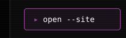</a><a href="https://www.linkedin.com/in/lucasbittar">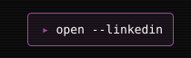</a><a href="https://lucasbittar.dev/resume.pdf">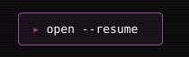</a><a href="https://substack.com/@lucasbittar">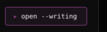</a>

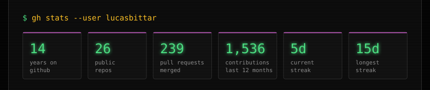

<a href="https://pabllovittar.digital">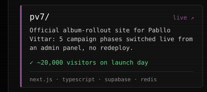</a><a href="https://github.com/lucasbittar/cartadeadeus">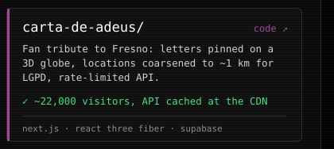</a>
<a href="https://github.com/lucasbittar/myscrobble">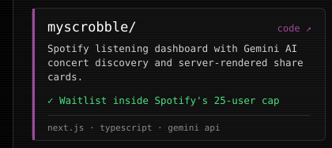</a><a href="https://github.com/lucasbittar/weatherapp">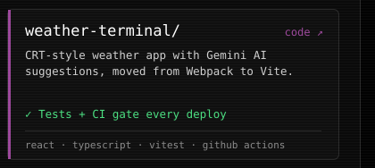</a>
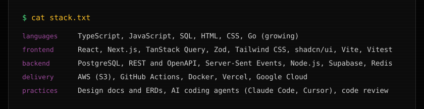
<a href="https://github.com/lucasbittar/dotfiles">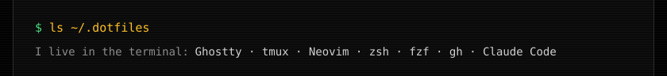</a>

<!-- terminal:end -->
